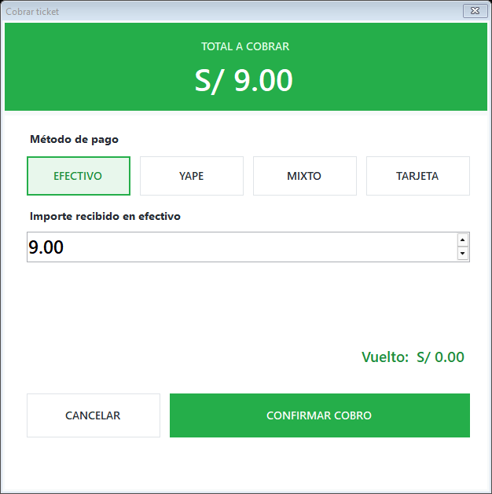

# Edén POS

Punto de venta táctil para Windows del **Sauna El Edén Cono Sur** (Tacna). Proyecto del curso de Gestión de Proyectos de TI (EPIS-UPT).

- **C# WinForms** sobre **.NET Framework 4.8**.
- Datos en **MySQL/MariaDB** (por defecto el MariaDB de XAMPP, puerto 3306, base `edenpos`).
- Copia automática a una carpeta (OneDrive/Google Drive) y **réplica opcional en Supabase** (PostgreSQL).

## Funciones

- **Ventas:** catálogo por categorías, variantes, tickets guardados con candados (1–35), adultos/niños, cobro en efectivo, Yape o mixto.
- **Promociones:** sexta visita gratis y descuento grupal/familiar (configurables, no acumulables).
- **Comprobantes:** facturación electrónica **simulada** con reintentos; las ventas mayores a S/ 700 exigen el documento del cliente.
- **Recibos:** búsqueda, filtros por estado de envío de la boleta, por fechas y por saldo pendiente, boletas no enviadas con reintento, detalle, reembolso, resumen por día y cobro posterior de saldos pendientes (autorizados por la dueña).
- **Turno y caja:** apertura y cierre, sin cobros con la caja cerrada, movimientos de caja en efectivo o Yape, efectivo y Yape esperados (incluidos los saldos cobrados en el turno), proyección del disponible y diferencia por medio de pago.
- **Inventario:** productos y variantes, entradas, stock mínimo con alerta.
- **Reportes** de caja, ventas, inventario y visitas por rango de fechas, y pantalla de **Auditoría** de operaciones sensibles.
- **Usuarios y roles:** la dueña administra; los trabajadores venden. PIN con hash y sal.
- **Consulta de DNI** opcional (token propio de ApiPeruDev, cifrado con la cuenta de Windows).
- **Varias cajas** contra la misma base: cobro y liberación de candados en una sola transacción, protección del catálogo y refresco automático de la pantalla cuando otra caja cambia datos.
- **Copias:** exportar/importar `.edenbackup`, copia automática al cerrar turno y cada día, y réplica en Supabase con restauración en una PC nueva.

## Requisitos

- Windows 10/11 con .NET Framework 4.8.
- [XAMPP](https://www.apachefriends.org/) con MySQL (MariaDB) encendido, o cualquier MySQL 8.x / MariaDB 10.4+.
- Para compilar: Visual Studio 2022 (escritorio .NET) o el SDK de .NET (`dotnet build`).

## Puesta en marcha

1. Encienda MySQL en el panel de XAMPP.
2. Cree la base con el esquema (el script crea la base `edenpos`):
   ```powershell
   cmd /c '"C:\xampp\mysql\bin\mysql.exe" -u root --default-character-set=utf8mb4 < devdb\schema.sql'
   ```
3. Compile y ejecute:
   ```powershell
   dotnet build EdenPOS.csproj -c Release
   .\bin\Release\net48\EdenPOS.exe
   ```
4. Primer inicio: usuario `DUEÑA`, PIN `0000`. Cámbielo en **Configuración → Usuarios**.

Opcional: `devdb\seed\GenerarDatosPrueba.ps1` carga datos de prueba (ver `devdb\seed\DATOS_PRUEBA.md`).

Variables de entorno: `EDENPOS_MYSQL_CONNECTION` (otra cadena de conexión) y `EDENPOS_DATA_PATH` (otra carpeta de datos locales).

### Conexión y seguridad

La conexión local predeterminada con `root` sin contraseña se conserva para el
primer inicio con XAMPP. Para uso real, configure `EDENPOS_MYSQL_CONNECTION` con
un usuario propio y permisos limitados a la base de la aplicación; use TLS con
`SslMode=VerifyFull` si accede a un servidor remoto y configure su certificado CA.

Si existe una configuración local dañada o que otra cuenta de Windows no puede
descifrar, el inicio se detiene con un mensaje de error. Recupere `settings.json`
o configure una conexión válida mediante la variable de entorno; no se cambia
silenciosamente al usuario predeterminado.

Cada conexión restablece su sesión y activa el modo SQL estricto. La aplicación
mantiene habilitada la comprobación de transacciones y deshabilita la carga de
archivos locales y la conservación de contraseñas en conexiones abiertas, aunque
la cadena de conexión intente cambiar esas opciones.

## Copia en la nube

- **Carpeta:** Configuración → Copias de seguridad y datos → Copia automática. Elija una carpeta de OneDrive o Google Drive.
- **Supabase:** siga `devdb\supabase\LEEME.md` (script `01_esquema_replica.sql`, luego Configuración → Réplica en Supabase). Actívela solo en la PC que tiene la base principal. Si su proyecto ya tenía la réplica de una versión anterior, vuelva a ejecutar `01_esquema_replica.sql` (no borra datos): mientras no lo haga, la réplica no copia saldos pendientes, medios de pago de la caja ni el tipo de los artículos, y la pantalla lo avisa.

## Estructura

| Ruta | Contenido |
|---|---|
| `*.cs` | Código de la aplicación (`Infrastructure.cs` es la fachada de datos `AppData`) |
| `devdb/schema.sql` | Esquema MySQL/MariaDB |
| `devdb/supabase/` | Scripts y guía de la réplica en Supabase |
| `devdb/seed/`, `devdb/tools/` | Datos de prueba y herramientas de capturas |
| `devdb/capturas/` | Capturas antes/después del rediseño (`comparativa.html`) |
| `devdb/tests/` | Pruebas de regresión |
| `docs/img/` | Capturas de pantalla de la aplicación |
| `SPEC.md`, `tasks/` | Especificación y plan de trabajo |

## Requerimientos (FD03) y dónde están

| Requerimiento | Pantalla | Código |
|---|---|---|
| RF-01 Autenticar usuarios | Inicio de sesión | `LoginForm.cs`, `AppData.TryLogin` (bloqueo tras 5 intentos) y cierre por inactividad en `MainForm.cs` |
| RF-02 Usuarios y roles | Configuración → Usuarios | `UserManagement.cs` |
| RF-03 Apertura de caja | Turno | `ShiftView.cs`, `AppData.OpenNewShift` |
| RN-02 No se cobra sin caja abierta | Ventas → Cobrar (aviso antes de abrir el cobro; el ticket se conserva) | `SalesView.cs`, `AppData.AddReceipt` (lanza "Abra un turno antes de cobrar." y bloquea el turno con `LOCK IN SHARE MODE` para que un cierre en otra caja no deje ventas fuera) |
| RF-04 Movimientos de caja en efectivo o Yape | Turno → Registrar movimiento | `ShiftView.cs` (`TreasuryDialog`), `AppData.AddCashMovement` (columna `movimiento_caja.medio`; solo los de efectivo cambian el efectivo esperado), `devdb/migraciones/007_caja_medios.sql` |
| RF-05 Cierre por medio de pago y proyección del disponible | Turno → Cerrar turno, Reportes → Caja | `AppData.GetShiftBalance` / `CloseShift` (efectivo contado y Yape confirmado; columnas `sesion_caja.yape_esperado` y `yape_contado`), `Reports.cs`, `ReportsView.cs` |
| RN-09 Observación obligatoria si la caja no cuadra (efectivo o Yape) | Turno → Cerrar turno, Reportes → Caja y Auditoría | `AppData.CloseShift` (columna `sesion_caja.observacion_cierre`) |
| RF-06 Registrar cliente (RN-14, RNF-09) | Ventas (DNI, nombre, teléfono y casilla de consentimiento) | `SalesView.cs`, `AppData.SaveCustomer` (DNI y teléfono solo con consentimiento, Ley N.º 29733), `Validation.IsValidPhone` |
| RF-07 a RF-10 Visita, casilleros, consumos y cobro | Ventas | `SalesView.cs`, `Dialogs.cs`, `AppData.AddReceipt` |
| RN-01 Pago al terminar la visita; saldo pendiente solo con autorización de la dueña | Cobro (Dejar saldo pendiente: PIN de la dueña y motivo), Recibos (Cobrar saldo y filtro Con saldo pendiente), Reportes y Auditoría | `Dialogs.cs` (`CheckoutDialog`, `PendingBalanceDialog`), `AppData.AddReceipt` (valida dueña, PIN, motivo y pagado + saldo = total), `AppData.CollectBalance` en `Visits.cs`, columnas `recibo.saldo_*` (`devdb/migraciones/008_visitas_saldo.sql`) |
| RF-20 Visitas activas: tiempo y saldo | Ventas → Tickets guardados | `Dialogs.cs` (`SavedTicketsDialog`, columnas Tiempo y Por cobrar) |
| RN-12 Reembolsos y ajustes solo de la dueña, con motivo | Recibos → Reembolsar, Inventario → Registrar salida | `AppData.RefundReceipt`, `AppData.AddInventoryAdjustment` |
| RF-11 Promociones | Cobro y Configuración → Promociones | `Promotions.cs` |
| RF-12 Boletas (simuladas) | Recibos y Configuración → Facturación | `ElectronicInvoicing.cs` |
| RF-13 Consultar recibos y boletas | Recibos: búsqueda por número, DNI, cliente o pago, filtro por estado de envío de la boleta (Aceptado, Pendiente, Rechazado) y rango de fechas | `ReceiptsView.cs` (`FilterReceipts`) |
| RF-21 Boletas no enviadas y reintento | Recibos → Boletas no enviadas y Configuración → Facturación → Ver boletas no enviadas (número, fecha, cliente, total, estado, intentos, último código y mensaje; Reintentar este / Reintentar todos). El reintento automático sigue cada 5 minutos | `PendingInvoicesDialog.cs`, `AppData.GetComprobantesNoEnviados`, `ProcesarComprobante`, `ReintentarComprobantes` (columna `comprobante.mensaje_respuesta`) |
| RF-12 / RNF-07 Impresión del recibo en la térmica de 80 mm | Recibos → Imprimir, cobro en Ventas y Configuración → Impresora | `ReceiptPrinting.cs` (tabla `impresora_pc` por PC, `devdb/migraciones/006_rf12_impresora.sql`) |
| RF-14 a RF-16 Inventario y stock mínimo | Inventario | `ProductsView.cs` |
| RF-14 Tipo de artículo: Producto o Implemento | Inventario (columna Tipo) → Editar artículo | `ProductsView.cs`, `ProductTypes` en `Models.cs` (columna `producto.tipo`; solo los implementos tienen cargo por pérdida y se revisan al cobrar la visita) |
| RF-15 Pérdidas, consumo interno y ajustes con motivo | Inventario → Registrar salida, Reportes → Inventario | `ProductsView.cs` (`InventoryAdjustmentDialog`), `AppData.AddInventoryAdjustment` |
| RF-17 Reportes | Reportes | `Reports.cs`, `ReportsView.cs` |
| RF-17 Visitas por rango de fechas | Reportes → Visitas | `AppData.GetVisitReport` en `Visits.cs` (visita = ticket guardado o línea SAUNA; personas con `OccupancyCalculator`; duración con `recibo.ingreso_at`), `ReportsView.cs` (grid y CSV) |
| RF-18 Respaldos | Configuración → Copias de seguridad | `AutoBackup.cs`, `SupabaseReplica.cs` |
| RF-19, RN-06, RN-07 y RF-22 (cargos por pérdida) Devolución de llaves e implementos | Cobro de un ticket con llaves, Configuración → Cargos por pérdida e Inventario → Editar artículo | `KeyReturns.cs`, `KeyReturnDialog.cs`, `AppData.AddReceipt` (valida los cargos; las llaves no devueltas quedan fuera de uso hasta que la dueña las libera) |
| RNF-03 Seguridad del PIN | — | `Security.cs` (PBKDF2 con sal) |
| RNF-04 Trazabilidad | Auditoría | `AuditView.cs`, `AppData.RegistrarAuditoria` (todo cierre de caja queda como `CAJA_CERRADA` con esperado y contado de efectivo y Yape; si no cuadra, además `CAJA_DIFERENCIA`) |
| RNF-09 / RN-14 Retiro del consentimiento y protección de datos | Configuración → Clientes → Buscar cliente → Retirar consentimiento (solo la dueña) | `CustomerPrivacy.cs`, `CustomerPrivacyDialog.cs`: borra el teléfono y anonimiza el DNI (los recibos mayores a S/ 700 lo conservan por SUNAT), columna `cliente.consentimiento_revocado`, auditoría `CONSENTIMIENTO_RETIRADO`; la exportación manual de copias queda como `DATOS_EXPORTADOS` y la importación de datos antiguos no guarda clientes sin consentimiento |

## Capturas




## Atajos

`F2` Ventas · `F3` Recibos · `F4` Turno · `F5` Actualizar

## Recursos gráficos

Iconos de catálogo de Twemoji bajo CC BY 4.0: ver `THIRD_PARTY_NOTICES.txt` y `Assets\Catalog\SOURCES.md`.
