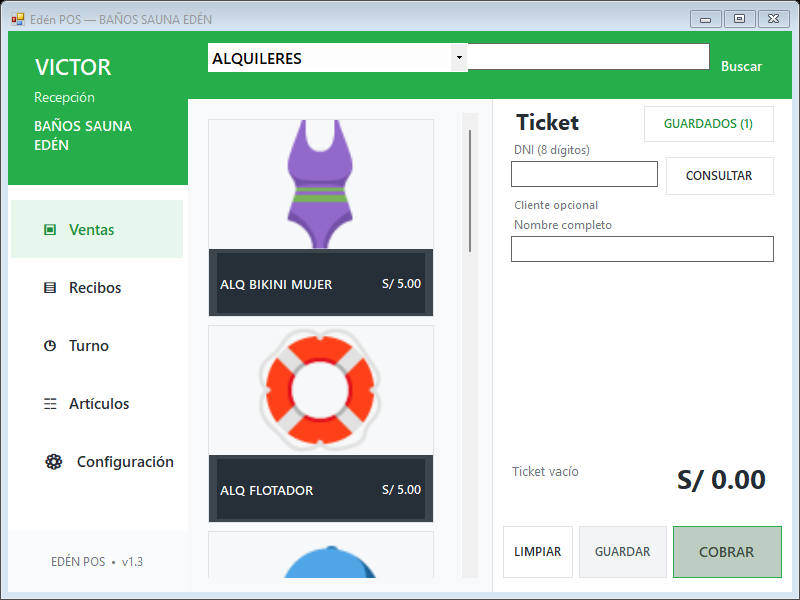
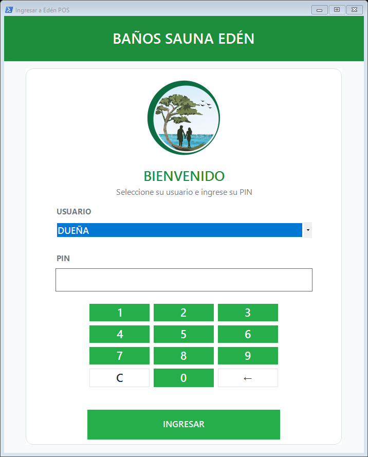

# Edén POS

Punto de venta táctil para Windows del **Sauna El Edén Cono Sur** (Tacna). Proyecto del curso de Gestión de Proyectos de TI (EPIS-UPT).

- **C# WinForms** sobre **.NET Framework 4.8**.
- Datos en **MySQL/MariaDB** (por defecto el MariaDB de XAMPP, puerto 3306, base `edenpos`).
- Copia automática a una carpeta (OneDrive/Google Drive) y **réplica opcional en Supabase** (PostgreSQL).

## Funciones

- **Ventas:** catálogo por categorías, variantes, tickets guardados con candados (1–35), adultos/niños, cobro en efectivo, Yape o mixto.
- **Promociones:** sexta visita gratis y descuento grupal/familiar (configurables, no acumulables).
- **Comprobantes:** facturación electrónica **simulada** con reintentos; las ventas mayores a S/ 700 exigen el documento del cliente.
- **Recibos:** búsqueda, detalle, reembolso y resumen por día.
- **Turno y caja:** apertura y cierre, movimientos de caja, efectivo esperado y diferencia.
- **Inventario:** productos y variantes, entradas, stock mínimo con alerta.
- **Reportes** de caja, ventas e inventario por rango de fechas, y pantalla de **Auditoría** de operaciones sensibles.
- **Usuarios y roles:** la dueña administra; los trabajadores venden. PIN con hash y sal.
- **Consulta de DNI** opcional (token propio de ApiPeruDev, cifrado con la cuenta de Windows).
- **Varias cajas** contra la misma base: cobro y liberación de candados en una sola transacción, protección del catálogo y refresco automático de la pantalla cuando otra caja cambia datos.
- **Copias:** exportar/importar `.edenbackup`, copia automática al cerrar turno y cada día, y réplica en Supabase con restauración en una PC nueva.

## Requisitos

- Windows 10/11 con .NET Framework 4.8.
- [XAMPP](https://www.apachefriends.org/) con MySQL (MariaDB) encendido, o cualquier MySQL 8.x / MariaDB 10.4+.
- Para compilar: Visual Studio 2022 (escritorio .NET) o el SDK de .NET (`dotnet build`).

## Puesta en marcha

1. Encienda MySQL en el panel de XAMPP.
2. Cree la base con el esquema (el script crea la base `edenpos`):
   ```powershell
   cmd /c '"C:\xampp\mysql\bin\mysql.exe" -u root --default-character-set=utf8mb4 < devdb\schema.sql'
   ```
3. Compile y ejecute:
   ```powershell
   dotnet build EdenPOS.csproj -c Release
   .\bin\Release\net48\EdenPOS.exe
   ```
4. Primer inicio: usuario `DUEÑA`, PIN `0000`. Cámbielo en **Configuración → Usuarios**.

Opcional: `devdb\seed\GenerarDatosPrueba.ps1` carga datos de prueba (ver `devdb\seed\DATOS_PRUEBA.md`).

Variables de entorno: `EDENPOS_MYSQL_CONNECTION` (otra cadena de conexión) y `EDENPOS_DATA_PATH` (otra carpeta de datos locales).

### Conexión y seguridad

La conexión local predeterminada con `root` sin contraseña se conserva para el
primer inicio con XAMPP. Para uso real, configure `EDENPOS_MYSQL_CONNECTION` con
un usuario propio y permisos limitados a la base de la aplicación; use TLS con
`SslMode=VerifyFull` si accede a un servidor remoto y configure su certificado CA.

Si existe una configuración local dañada o que otra cuenta de Windows no puede
descifrar, el inicio se detiene con un mensaje de error. Recupere `settings.json`
o configure una conexión válida mediante la variable de entorno; no se cambia
silenciosamente al usuario predeterminado.

Cada conexión restablece su sesión y activa el modo SQL estricto. La aplicación
mantiene habilitada la comprobación de transacciones y deshabilita la carga de
archivos locales y la conservación de contraseñas en conexiones abiertas, aunque
la cadena de conexión intente cambiar esas opciones.

## Copia en la nube

- **Carpeta:** Configuración → Copias de seguridad y datos → Copia automática. Elija una carpeta de OneDrive o Google Drive.
- **Supabase:** siga `devdb\supabase\LEEME.md` (script `01_esquema_replica.sql`, luego Configuración → Réplica en Supabase). Actívela solo en la PC que tiene la base principal.

## Estructura

| Ruta | Contenido |
|---|---|
| `*.cs` | Código de la aplicación (`Infrastructure.cs` es la fachada de datos `AppData`) |
| `devdb/schema.sql` | Esquema MySQL/MariaDB |
| `devdb/supabase/` | Scripts y guía de la réplica en Supabase |
| `devdb/seed/`, `devdb/tools/` | Datos de prueba y herramientas de capturas |
| `devdb/capturas/` | Capturas antes/después del rediseño (`comparativa.html`) |
| `devdb/tests/` | Pruebas de regresión |
| `docs/img/` | Capturas de pantalla de la aplicación |
| `SPEC.md`, `tasks/` | Especificación y plan de trabajo |

## Requerimientos (FD03) y dónde están

| Requerimiento | Pantalla | Código |
|---|---|---|
| RF-01 Autenticar usuarios | Inicio de sesión | `LoginForm.cs`, `AppData.TryLogin` (bloqueo tras 5 intentos) y cierre por inactividad en `MainForm.cs` |
| RF-02 Usuarios y roles | Configuración → Usuarios | `UserManagement.cs` |
| RF-03, RF-04, RF-05 Caja | Turno | `ShiftView.cs`, `AppData.OpenNewShift` / `CloseShift` |
| RF-07 a RF-10 Visita, casilleros, consumos y cobro | Ventas | `SalesView.cs`, `Dialogs.cs`, `AppData.AddReceipt` |
| RF-11 Promociones | Cobro y Configuración → Promociones | `Promotions.cs` |
| RF-12, RF-13, RF-21 Boletas (simuladas) | Recibos y Configuración → Facturación | `ElectronicInvoicing.cs` |
| RF-14 a RF-16 Inventario y stock mínimo | Inventario | `ProductsView.cs` |
| RF-17 Reportes | Reportes | `Reports.cs`, `ReportsView.cs` |
| RF-18 Respaldos | Configuración → Copias de seguridad | `AutoBackup.cs`, `SupabaseReplica.cs` |
| RNF-03 Seguridad del PIN | — | `Security.cs` (PBKDF2 con sal) |
| RNF-04 Trazabilidad | Auditoría | `AuditView.cs`, `AppData.RegistrarAuditoria` |

## Capturas





## Atajos

`F2` Ventas · `F3` Recibos · `F4` Turno · `F5` Actualizar

## Recursos gráficos

Iconos de catálogo de Twemoji bajo CC BY 4.0: ver `THIRD_PARTY_NOTICES.txt` y `Assets\Catalog\SOURCES.md`.
